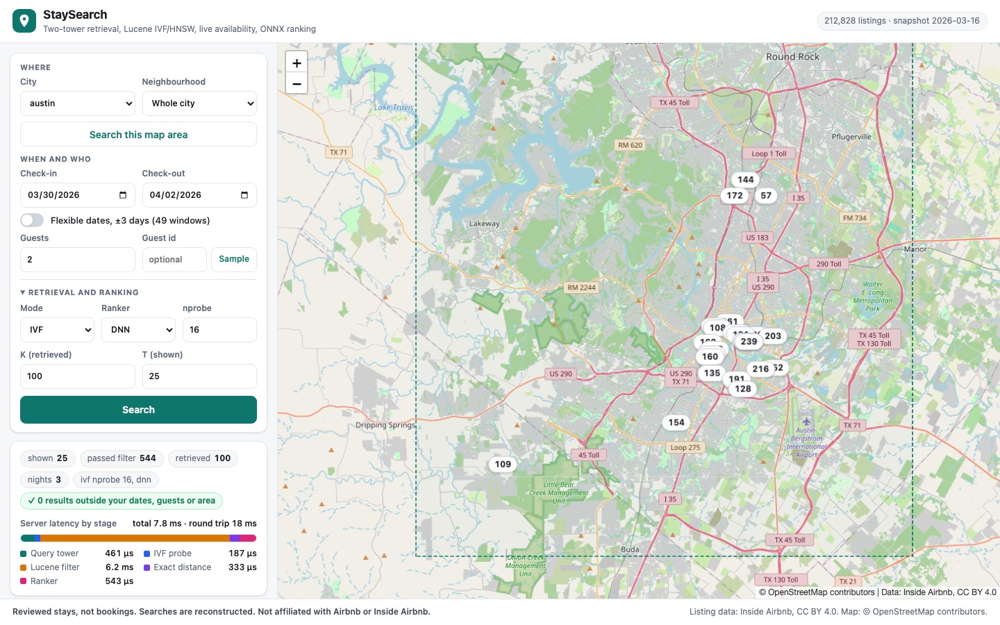

# StaySearch

StaySearch is a vacation-rental search and relevance system built on public data: a two-tower
retrieval model trained in PyTorch, a clustered (IVF) index whose cluster id is an ordinary Apache
Lucene filter, an O(1) availability structure that takes live calendar updates, and LightGBM and
neural rankers, served from one Kotlin service through ONNX Runtime. It rebuilds a published
search design (credited in [DESIGN.md](DESIGN.md)) on real listings, calendars and reviews from
[Inside Airbnb](https://insideairbnb.com/get-the-data/) (CC BY 4.0) for ten cities, to measure the
trade-offs that design describes. **What it does not claim:** there are no searches, clicks or
bookings in public data, so the positive label is a **reviewed stay** (a home the guest went on to
review, which Inside Airbnb estimates covers about half of stays), and the search behind each
positive (dates, nights, guests, area) is **reconstructed** from the review date and the listing's
rules; experiment exp8 measures how much that reconstruction leaks. Hard negatives are substitutes
for the behavioural negatives a real search log would give. A closed calendar night is booked or
blocked by the host, indistinguishably. Price is one quote per listing, not per night, and some
snapshots have none (carried forward point in time). Scale is one laptop, not a marketplace. This
project is not affiliated with, endorsed by, or connected to Airbnb or Inside Airbnb.

<!-- RESULTS-START -->


## Results

Ten cities (Seattle, San Diego, San Francisco, Los Angeles, New York City, Boston, Chicago, Austin,
London, Paris), four quarterly snapshots each. Every number below is on the **test split**: reviewed
stays whose reconstructed check-in falls after the March 2026 snapshot, scored against that
snapshot's **point-in-time eligible set** (212,828 listings in the snapshot; median eligible set
1,002 homes). 95% bootstrap intervals in brackets. Every figure is in [NUMBERS.md](NUMBERS.md) with
the `results/*.jsonl` file it came from; that file records the machine and its load.

**Retrieval (exp1, 20,000 test queries).** How often the home the guest went on to review is in the top 100:

| Retriever | recall@10 | recall@100 | recall@500 |
|---|---|---|---|
| Random order | 9.3% | 34.4% | 56.2% |
| Distance from the area centre | 11.0% | 36.9% [36.2, 37.6] | 58.2% |
| Popularity (reviews in the last 12 months) | 18.2% | 47.2% [46.5, 47.9] | 69.5% |
| Query-independent linear score (the paper's legacy baseline) | 18.2% | 47.1% [46.4, 47.7] | 69.7% |
| **Two-tower, Euclidean, mixed hard negatives, guest history** | **21.2%** | **51.1% [50.4, 51.8]** | **73.0%** |
| Same, guests with earlier reviewed stays (5,920 queries) | 24.6% | 55.8% [54.5, 57.1] | 77.1% |

- **Guest history** is worth 2.3 points of recall@100 overall and 6.7 points on guests who have
  history (55.8% vs 49.1% for the same model without it; popularity gets 47.8% on that slice).
- **Hard negatives did not matter here (exp2).** Every sampler arm (in-batch only, random,
  geo-hard, price-hard, model-mined, the mix) lands between 50.5% and 51.1%. The paper found random
  negatives too easy; with review-proxy positives and within-city in-batch negatives we cannot
  reproduce that gap. Reported as a disagreement, not tuned away.
- **The reconstruction leak is small (exp8).** Zeroing guests and nights in the query tower costs
  1.3 points (51.1% to 49.8%), under the two-point threshold set before measuring.

**Clustering and the index (exp3, against 2601.06873 Table 2).** IVF with 128 clusters, recall@100
of the IVF result against exact search, over all listings:

| nprobe | 2 | 4 | 16 | 32 |
|---|---|---|---|---|
| Euclidean (ours) | 41% | 58% | 84% | 94% |
| Dot product (ours) | 34% | 48% | 75% | 87% |
| Euclidean (paper) | 71% | 75% | 98% | 100% |
| Dot product (paper) | 43% | 47% | 66% | 84% |

- **Partly reproduced.** Euclidean beats dot product at every nprobe, as in the paper. The paper's
  cause, a dot-product clustering with one or two clusters holding about 20% of listings, did
  **not** reproduce: both of our models cluster evenly (largest of 128 clusters: 3.8% Euclidean,
  3.9% dot), because our dot-model embedding norms are tight (1st to 99th percentile 12.6 to 22.6).
  The Bachrach inner-product-to-Euclidean transform keeps the clusters even but cuts recall at small
  nprobe (9% at nprobe 2), consistent with the paper's note that it did not help.
- **Filters hurt graph search.** Restricted to each query's eligible set, IVF at nprobe 32 keeps
  90.6% recall against exact; FAISS HNSW (M=32) with an ID-selector filter keeps 71.7% even at
  efSearch 512 (92.0% unfiltered). FAISS stores 264 bytes per vector for IVF-Flat and 528 for
  HNSW-Flat, and `remove_ids` works on IVF and is not implemented for HNSW (verified, not assumed).

**Ranking (exp6, top 100 from the two-tower, 10,000 test queries).** NDCG@10 of the reviewed stay:

| Ranker | NDCG@10 | with guest history |
|---|---|---|
| Review score | 0.052 | 0.061 |
| Price, cheapest first | 0.069 | 0.079 |
| Popularity | 0.104 | 0.104 |
| Retrieval order (two-tower distance) | 0.117 [0.112, 0.123] | 0.135 |
| LambdaMART (LightGBM) | 0.125 | 0.140 |
| Pairwise DNN | 0.126 | 0.142 |
| Pairwise DNN with guest-history features | 0.129 | 0.149 |
| **LambdaMART with guest-history features** | **0.132 [0.127, 0.137]** | **0.155** |

GBDT and the DNN finish level, which is the KDD'19 story at small scale: the DNN does not beat a
tuned GBDT without much more data. The gain over retrieval comes mostly from query-time calendar
features (does the stay fill a gap in the host's calendar) and guest history. **Replay recall
(exp7):** the two-tower's top 100 recovers 56.1% of LambdaMART's top 100 over the full eligible set
(62.6% of the DNN's), against 54.7% for the linear baseline and 35.9% for geo distance.

**Serving (Kotlin, Lucene 10, ONNX Runtime).**

- **0 hard-invariant violations** over 31,429 searches on 10,000 real test queries (IVF, HNSW and
  exact modes, 763,404 returned homes each checked night by night) with 100,000 real calendar,
  price and listing updates applied between queries.
- ONNX parity: the query tower in ONNX Runtime Java matches PyTorch to a max absolute difference of
  1.1e-5 over 10,000 queries; golden files hold the Python and Kotlin feature code together (87
  query features, 45 ranker features).
- Availability check (JMH): about 11 ns per stay regardless of length; all 49 flexible-date windows
  in about 100 ns, against 153 to 249 ns for a per-night scan as stays grow from 7 to 28 nights.
- Flexible dates (plus or minus 3 days): one 49-window pass answers in 1.48 ms p50 against 42.7 ms
  for 49 separate searches, and grows the eligible set 1.6x at the median.
<!-- EXP4-LATENCY -->

**Position bias (M5, SIMULATED).** On simulated examination and choice over real candidate lists,
position as a DNN feature with dropout and zero at inference (KDD'20) did not recover the true
ordering better than ignoring position (Kendall tau 0.646 vs 0.671 under strong bias). A separate
additive position tower dropped at inference did (0.682). Labelled simulated everywhere.

**Diversity (M6).** Greedy re-ranking after *Learning To Rank Diversely*: at lambda 1, the top 10
spreads 9% wider geographically and 10% wider in price for 2% of NDCG@10 (0.127 to 0.125).
<!-- RESULTS-END -->

## How it works

```
 offline (Python)                                     online (Kotlin, one JVM)
 Inside Airbnb gz -> Parquet (DuckDB)                 /search {place|bbox, checkin, checkout, guests, guest_id?}
 labels + point-in-time eligible sets + samplers        1. query tower (ONNX Runtime), guest history from a KV map
 two-tower training (PyTorch)                           2. nprobe nearest IVF centroids
 listing tower batch -> embeddings                      3. Lucene: cluster_id IN (...) AND LatLonPoint box
 k-means (FAISS) -> centroids, cluster ids                 AND capacity AND nights AND availability (custom Query)
 LightGBM + DNN rankers -> ONNX                         4. exact distance on the candidates, top K
 snapshot diffs -> real update stream                   5. ranker (ONNX) over K, top T
                                                      update consumer: calendar/price/listing events -> in-place
                                                         availability store + Lucene updateDocument + NRT refresh
```

- **Labels** ([DESIGN.md](DESIGN.md) section 2): a review becomes a reviewed stay; check-out, nights,
  guests and area are reconstructed; the eligible set is every listing in the area that was open
  for those nights in the calendar of the snapshot before the stay, and positives that were not
  open then are dropped and counted.
- **Time split:** towers train on stays before the first snapshot, rankers on the next quarter,
  validation on the one after, and every reported number on the last quarter (March to June 2026).
- **Update stream:** real calendar flips, price changes and new or removed listings between the
  March and June 2026 snapshots, replayed in-process at 100 to 10,000 events/s (not a broker).

## Layout

| Path | What |
|---|---|
| `staysearch/ingest/download.py` | Quarter discovery by probing, streaming gz to Parquet under a disk budget |
| `staysearch/features.py` | Point-in-time listing features, S2 cells, amenities vocabulary |
| `staysearch/labels.py` | Reviewed stays, reconstructed searches, splits, eligibility, trips, history |
| `staysearch/updates.py` | The update stream from snapshot diffs |
| `staysearch/samplers.py` | Random, geo-hard, price-hard and model-mined negatives, false-negative guard |
| `staysearch/train_towers.py`, `towers.py` | Two-tower model and training |
| `staysearch/evaluate.py`, `baselines.py` | Point-in-time evaluation and the M1 baselines |
| `service/` | The Kotlin service: Lucene index, availability store, ONNX models, experiments |
| `results/*.jsonl` | Every measurement, with machine and load |

## Reproduce

```bash
python -m venv .venv && .venv/bin/pip install -r requirements.txt
python -m staysearch.ingest.download      # about 270 MB of Parquet for 10 cities x 4 snapshots
python -m staysearch.features && python -m staysearch.labels && python -m staysearch.updates
python -m staysearch.m0_report
python -m staysearch.baselines
python -m staysearch.train_towers --name mix_l2 --sampler mix --similarity l2
pytest -q tests
cd service && ./gradlew build
```

## Data and license

Listing, calendar and review data: Inside Airbnb, https://insideairbnb.com/get-the-data/, licensed
under a Creative Commons Attribution 4.0 International License. The data is not in this repository;
the download script fetches it. Inside Airbnb's assumptions page is the source for the review rate
and length-of-stay figures used in the reconstruction.
